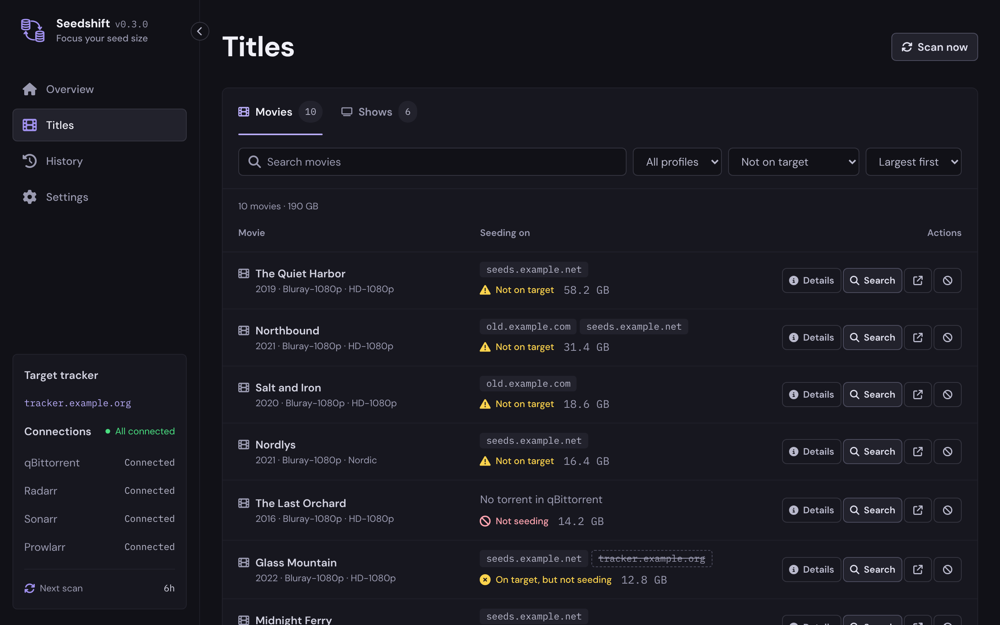
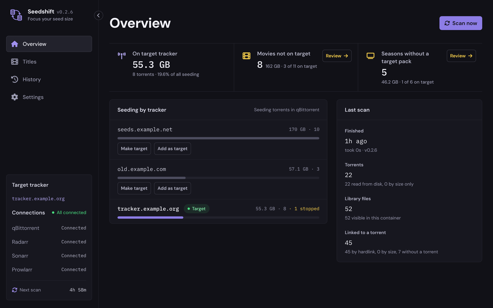
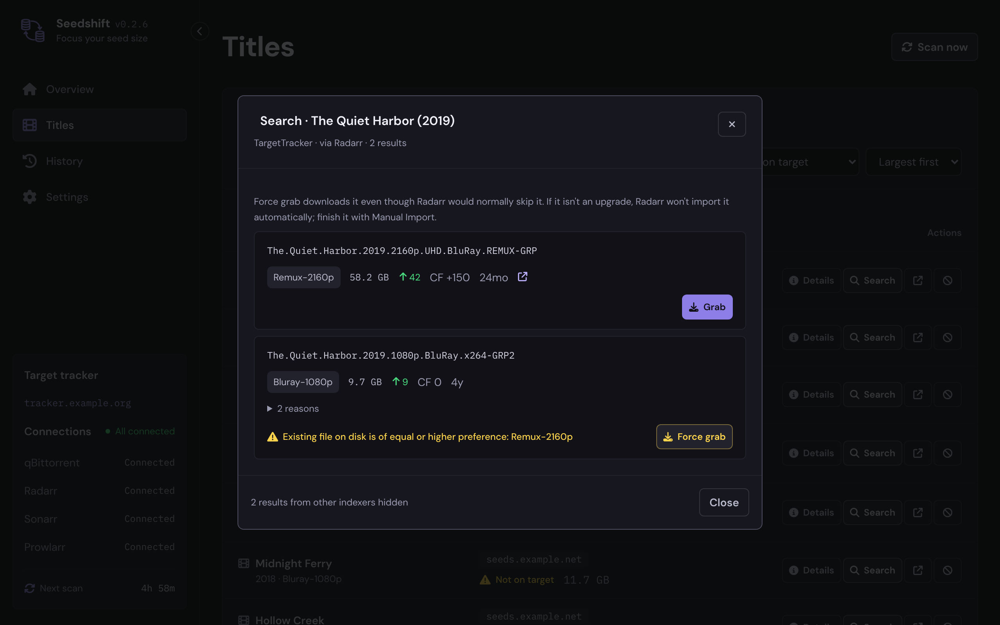

# Seedshift

Got a tracker you want to focus on? Seedshift tracks down every title that isn't on it yet.

It lists every movie and season that isn't seeding on your target tracker, and lets you search and grab it there through Radarr or Sonarr.



> [!IMPORTANT]
> **Built by AI.** The code, interface and docs are written by an AI model. The maintainer decides what to build, tests every release on a real server and publishes it. Read the code before you trust it, and report anything that looks off.

## Table of Contents

- [Security](#security)
- [Background](#background)
- [Install](#install)
- [Usage](#usage)
- [How it decides](#how-it-decides)
- [Searching the target](#searching-the-target)
- [Finish import](#finish-import)
- [Screenshot mode](#screenshot-mode)
- [History](#history)
- [Settings](#settings)
- [Troubleshooting](#troubleshooting)
- [Maintainers](#maintainers)
- [Contributing](#contributing)
- [License](#license)

## Security

- There's no login. Keep Seedshift on your local network and don't expose it to the internet.
- Scans only read. Seedshift never changes anything in qBittorrent or your files, and the data share is mounted read-only.
- The only thing that changes anything is **Grab**, after you confirm it. It asks Radarr or Sonarr to download the release, just like their own Grab button.
- With **Replace my file after a grab** on (off by default), Seedshift also asks Radarr or Sonarr to import what you grabbed over your current file. That still goes through the Arr.
- **Finish import**, after you confirm it, asks Sonarr to import episodes from a season pack that's already in qBittorrent. Sonarr copies or hardlinks them, so the torrent keeps seeding.
- Tracker passkeys are never stored or shown, only tracker host names.
- API keys and passwords are stored in `/config/settings.json`, readable only by the container's user.

## Background

Most people seed on several trackers. If you want to build up your seed size on one of them, you need to know which titles in your library aren't seeding there yet. Checking that by hand, title by title, takes forever.

Seedshift does the checking for you. It links every file in Radarr and Sonarr to the torrents in qBittorrent, using hardlinks where possible and file size otherwise, and reads which tracker each torrent is on. TV is judged by season, because what you usually want on your main tracker is a season pack, not scattered episodes.

## Install

### Dependencies

- Docker with Docker Compose
- qBittorrent (one or more)
- Radarr and/or Sonarr
- Optional: Prowlarr, to search only your target tracker
- Recommended: one data share with hardlinks between downloads and media. Without hardlinks, matching falls back to file size.

### Docker Compose

```yaml
services:
  seedshift:
    image: ghcr.io/grompty/seedshift:latest
    container_name: seedshift
    volumes:
      - /path/to/data:/data:ro
      - ./config:/config
    ports:
      - "8095:8080"
    restart: unless-stopped
```

- Mount the **same share** qBittorrent, Radarr and Sonarr use, at the **same path** they use (usually `/data`). Then no path mappings are needed.
- `:ro` keeps it read-only. Seedshift never writes to your media.
- Optional: if your other containers share a Docker network, add Seedshift to it and use container names like `http://radarr:7878` in Settings. IP addresses work too.
- Optional: to run as a specific user, add `user: "UID:GID"`. Find the values with `id`.

On Unraid:

```yaml
    volumes:
      - /mnt/user/data:/data:ro
      - /mnt/user/appdata/seedshift/config:/config
```

Start it:

```bash
docker compose up -d
```

To build the image yourself, see [CONTRIBUTING.md](CONTRIBUTING.md).

### Updating

```bash
docker compose pull && docker compose up -d
```

To stay on one release, use a version tag such as `ghcr.io/grompty/seedshift:0.3.2` instead of `latest`.

## Usage

Open Seedshift in your browser:

```
http://YOUR-SERVER:8095
```

1. **Settings → Connections:** add your qBittorrent clients (Web UI address, username, password), then Radarr and Sonarr (address and API key). Prowlarr is optional. Press **Test and save** for each one.
2. Press **Scan now**. Seedshift reads every torrent and every file in your library. The first scan of a big library can take a few minutes.
3. Pick your target tracker: press **Make target** next to it on the Overview, or enter it under **Settings → Target tracker**. Changing it later doesn't need a new scan.
4. Open **Titles**. Everything listed there isn't on your target yet, largest first. Use **Search** on a title to find it on the target and grab it.

> [!WARNING]
> Grabbing downloads from your target tracker, so it counts against your ratio there unless the release is freeleech. Go a few titles at a time. See [Mind your ratio](#searching-the-target).

### Screenshots

**Overview:** how much you seed on each tracker, and what's left to move.



**Search:** results from your target tracker only, with Grab and Force grab.



The screenshots use made-up titles and example tracker names.

### Path mappings

You only need these if an app sees the share at a different path than Seedshift. For example, if qBittorrent saves to `/downloads` and that folder is mounted at `/data/torrents` in Seedshift, add the mapping `/downloads` → `/data/torrents` under **Settings → Paths**. The Overview warns you when Seedshift can't see your library files.

## How it decides

Every movie and every season gets one status:

| Status | Meaning |
| --- | --- |
| On target | A torrent on your target tracker seeds it. For a season, one torrent has to cover every episode, so a season pack. |
| On target as singles | Every episode is on the target, but as separate torrents. |
| Partly on target | Some episodes are on the target. |
| On target, but not seeding | The target torrent exists but is stopped, errored or missing files. |
| Not on target | Seeding, but only on other trackers. |
| Not seeding | No torrent in qBittorrent seeds it at all, for example a Usenet download. |

Seasons that are still airing are hidden by default, since there's no pack yet. Incomplete seasons are flagged.

**Details** on a season shows where each episode comes from: the target pack, other torrents (with tracker, quality and release group), or nothing at all.

**Some titles will never be on your target**, for example Nordic movies when the target is an English tracker. If they have their own quality profile in Radarr or Sonarr, exclude it under **Settings → Target tracker → Exclude quality profiles**. Those titles are then left out of Titles and the Overview counts, and listed under **Titles → Ignored**. Titles also has a quality profile filter.

Files are linked to torrents by **hardlink** when Seedshift can see your data share, which is exact, and by **exact file size** otherwise. Cross-seeds count automatically.

## Searching the target

**Search** on a title shows releases from your target tracker only. For a show it searches the whole season, so season packs come first. **Grab** sends the release to Radarr or Sonarr, which download it with your usual quality profile, category and tags.

> [!WARNING]
> **Mind your ratio.** Every release you grab downloads from your target tracker and counts against your ratio there, unless it's freeleech. Moving a lot of seed size at once can drop your ratio quickly. Check the tracker's freeleech and ratio rules, keep a buffer, and grab a few titles at a time.

Under **Settings → Target tracker → Search with** you choose how:

- **Radarr / Sonarr** (default): uses their own interactive search, which searches all their indexers. Releases they'd normally skip get a **Force grab** button.
- **Prowlarr:** only your target tracker gets a search. If Radarr or Sonarr rejects the release, you'll see why.

Results can differ between the two. If one finds nothing, try the other.

**Not an upgrade?** If you grab the same quality you already have, Radarr and Sonarr download it but don't replace your file on their own. Finish it with **Manual Import** in Radarr or Sonarr.

### Replace my file after a grab

This setting is off by default.

> [!WARNING]
> When it's on, every release you grab through Seedshift replaces the file you have now once it's downloaded, even when Radarr or Sonarr doesn't consider it an upgrade. The old library file is deleted, or moved to the Arr's recycle bin if you've set one up. Your old torrent keeps seeding.

Seedshift follows each grab in the Arr's download queue. If the Arr imports it by itself, nothing more happens. If it's blocked as "not an upgrade", Seedshift has the Arr run a manual import over your current file. If it's blocked for any other reason, Seedshift leaves it alone and shows why on the History page.

**Already in qBittorrent** marks a release with the same name as a torrent you already have. Grabbing it again usually fails, since qBittorrent refuses duplicates. For a season, use [Finish import](#finish-import) instead.

**Possible match** marks a release from the same group as your file, at nearly the same size. It might be the release you already have, so it's worth a quick check before you grab it. It needs a scan from v0.2.4 or later.

## Finish import

Sometimes the target season pack is already in qBittorrent, but your library still holds other copies of some episodes. Sonarr skipped them as "not an upgrade", or you upgraded a few episodes later. The season then shows as partly on target, with a **Target pack in qBittorrent** tag.

Open **Details** on the season and press **Finish import**. Seedshift asks Sonarr which files in the pack match which episodes, and lists the episodes whose current file isn't from the pack: what you have now, and what the pack has. Tick the ones to replace and confirm. Sonarr imports them, and the next scan shows the season on target.

> [!WARNING]
> Finish import replaces your current files for the ticked episodes. The old files are deleted, or moved to Sonarr's recycle bin if you've set one up. Episodes where your current file is better than the pack's, such as a later Bluray, are unticked by default.

- Sonarr copies the files, or hardlinks them when hardlinks are on in Sonarr. It never moves them, so the pack keeps seeding. Your old torrents keep seeding too.
- Sonarr reads the pack's folder, at the path qBittorrent reports for it, so every file in the pack is considered. Files Sonarr can't use are listed with the reason.
- It also works for a pack Sonarr never imported from. Seedshift finds it by name.
- Episodes the pack doesn't contain stay as they are.
- Episodes that share one file now, like a double episode, are imported together, so none is left without a file.
- It needs a scan from v0.3.0 or later.

## Screenshot mode

Turn on **Screenshot mode** at the bottom of the sidebar before taking screenshots to share, for example in an issue. Titles, tracker hosts, indexer names, file paths and connection addresses are swapped for made-up ones, and the same real name always gets the same fake one. A label in the corner shows it's on. It only affects your browser, and settings can't be saved while it's on.

## History

The **History** page lists every grab and Finish import made through Seedshift: when, which release, through what, and the result, including rejections. With **Replace my file after a grab** on, it also shows where each grab is: downloading, imported, replaced, or blocked. Titles you've grabbed get a **Grabbed** tag on the Titles page. The newest 500 grabs are kept in `/config/history.jsonl`.

## Settings

| Setting | Default | What it does |
| --- | --- | --- |
| Target tracker | none | The tracker you want to focus on, by its announce host (for example `tracker.example.org`). Several hosts of the same site can be comma-separated, and subdomains count too. |
| Target indexer | picked automatically | Which indexer is your target, for **Search**. Picked automatically when an indexer's site matches the target tracker. |
| Search with | Radarr / Sonarr | Or Prowlarr, which only searches your target. |
| Exclude quality profiles | none | Titles on these Radarr/Sonarr profiles aren't expected on the target. They're left out of Titles and the counts. |
| Replace my file after a grab | off | Has Radarr/Sonarr import a grabbed release even when it isn't an upgrade. See the warning above. |
| Matching | Hardlink, then size | Or hardlink only, or size only. |
| Size match minimum | 50 MB | Smaller files are only matched by hardlink. |
| Automatic scan | every 6 hours | Or manual only. |
| Include specials | off | Counts Sonarr's season 0 as a season. |

Settings, API keys and passwords are stored in `/config/settings.json`. The last scan is kept in `/config/scan.json`.

## Troubleshooting

**qBittorrent says the username or password is wrong.** Use the same login as qBittorrent's Web UI. If qBittorrent skips the login for your local network, leave the username empty.

**Nothing is linked, or everything shows "Not seeding".** Seedshift can't see your files. Check that the data share is mounted at the same path the other apps use, or add a path mapping. The Overview shows a path it looked for.

**Search finds nothing, but the release is on the tracker.**
- The tracker may be down right now. Check the tracker's status, and the indexer's status in Prowlarr, Radarr or Sonarr.
- Check that the indexer has **interactive search** turned on in Radarr or Sonarr, and that the target indexer under **Settings → Target tracker** is the right one.
- Try the other **Search with** option. They can find different things.

**A grabbed release never gets imported.** It's probably not an upgrade over your current file. Finish it with **Manual Import** in Radarr or Sonarr, or for a season, with [Finish import](#finish-import).

**Sonarr or Radarr says "Failed to connect to qBittorrent" when grabbing, but its Test works.** Check the Arr's log. If it shows `409 Conflict` on `torrents/add`, qBittorrent refused the torrent because it's already there. Use [Finish import](#finish-import) for a season, or Manual Import in the Arr.

## Maintainers

Questions, bugs and ideas go to [GitHub Issues](https://github.com/grompty/seedshift/issues).

## Contributing

Pull requests are welcome. For bigger changes, open an issue first so we can agree on it before you put in the work.

To build the image yourself, run Seedshift from source or make a release, see [CONTRIBUTING.md](CONTRIBUTING.md).

Turn on [Screenshot mode](#screenshot-mode) before taking screenshots for an issue. When you report a bug, include your Seedshift version (shown on the Overview under **Last scan**) and the relevant part of `docker logs seedshift`. Remove API keys and passwords first.

## License

[MIT](LICENSE) © 2026 grompty
